# Informe – Escalamiento en Azure (vertical y horizontal)

**Escuela Colombiana de Ingeniería – Arquitecturas de Software (ARSW)**
Laboratorio: *Escalamiento en Azure con Máquinas Virtuales y balanceo de carga*

---

## Contexto y ajustes respecto al enunciado

El laboratorio se ejecutó en una suscripción **Azure for Students** con la política *Allowed resource deployment regions*, que solo permite `chilecentral`, `brazilsouth`, `mexicocentral`, `eastus2` y `centralus`. Las mismas restricciones de capacidad afectaron las dos partes, así que se hicieron estos ajustes:

| Enunciado | Ejecución real | Motivo |
|---|---|---|
| Ubuntu Server 18.04 | **Ubuntu Server 24.04 LTS** | 18.04 está fuera de soporte; Node LTS actual no corre en esa versión. |
| VM `Standard_B1ls` (1 vCPU, 0,5 GiB) | **`Standard_B2ats_v2`** (2 vCPU, 1 GiB, *burstable*) | `B1ls`, `B1s`, `B1ms`, `A1_v2`, `DS1_v2`, `D1_v2` y `F1s` devolvieron `SkuNotAvailable` (*Capacity Restrictions*) en todas las regiones permitidas. `B2ats_v2` es la VM *burstable* más pequeña con capacidad disponible, y solo la hubo en **México Central**. |
| Escalar a `Standard_B2ms` | **`Standard_B4as_v2`** (4 vCPU, 16 GiB) | `B2ms` devolvió `SkuNotAvailable` en México Central. |
| Load Balancer / IP SKU Basic | **Standard** | El SKU Basic se retiró el 30-sep-2025. |
| 4 VMs en la parte 2 | **3 VMs** (ver parte 2) | La cuota *Total Regional vCPUs* de la suscripción es **6**, y el tamaño mínimo disponible tiene 2 vCPU. |
| `npm FibonacciApp.js`, nvm 0.34 | `scripts/setup-vm.sh` (nvm 0.40.1, Node LTS, `forever`, arranque con `@reboot`) | Los comandos del enunciado están desactualizados. |

Las pruebas de carga se ejecutaron **desde un equipo externo a Azure** con newman 6.2.3 (`tools/load-test.js` lanza N ejecuciones de la colección en paralelo, equivalente a `newman run ... -n 10 &`). Los tiempos individuales se midieron con `tools/measure-times.js`, que hace peticiones secuenciales a `/fibonacci/{n}`.

---

## Parte 1 – Escalabilidad vertical

### 1.1 Creación de la VM y recursos asociados

VM `VERTICAL-SCALABILITY` en el grupo de recursos `SCALABILITY_LAB` (México Central), usuario `scalability_lab`, autenticación por llave SSH.

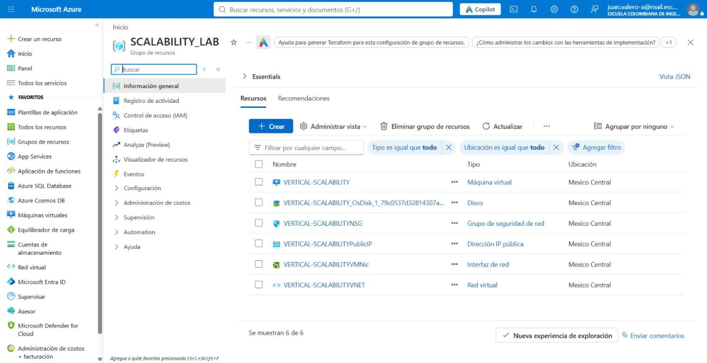

### 1.2 Inbound port rule para el puerto 3000

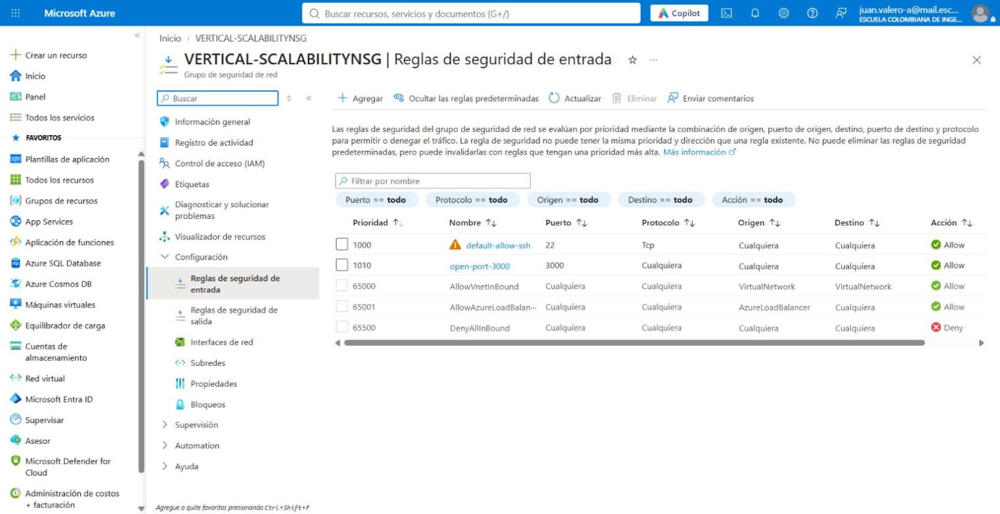

### 1.3 Instalación y verificación de la aplicación

La aplicación se instaló con `scripts/setup-vm.sh` por SSH: nvm, Node LTS, `git clone`, `npm install` y `forever start FibonacciApp.js`.

```
$ curl http://172.195.107.82:3000/fibonacci/6
The answer is 8
```

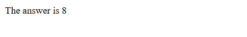

**Comportamiento sin `forever`** (pregunta 3). Se detuvo `forever`, se lanzó `node FibonacciApp.js` en primer plano dentro de una sesión SSH y luego se cerró la sesión:

```
forever detenido
Con la sesion ssh abierta:
The answer is 8
Despues de cerrar la sesion ssh:
000            <- curl sin respuesta: conexión rechazada
forever reiniciado
The answer is 8
```

### 1.4 Tiempos de respuesta (paso 7)

Peticiones secuenciales, una a la vez, desde el equipo cliente:

| n | `B2ats_v2` (ms) | `B4as_v2` (ms) |
|---|---|---|
| 1 000 000 | 6 535 | 6 484 |
| 1 010 000 | 6 496 | 6 146 |
| 1 020 000 | 6 589 | 6 319 |
| 1 030 000 | 6 733 | 6 362 |
| 1 040 000 | 6 781 | 6 460 |
| 1 050 000 | 7 177 | 6 657 |
| 1 060 000 | 7 208 | 6 717 |
| 1 070 000 | 7 234 | 6 903 |
| 1 080 000 | 7 377 | 7 024 |
| 1 090 000 | 7 572 | 7 160 |
| **Promedio** | **6 970** | **6 623** |

### 1.5 Consumo de CPU (pasos 8 y 11)

Métrica `Percentage CPU`, agregación **Max**, durante las pruebas con el tamaño inicial:

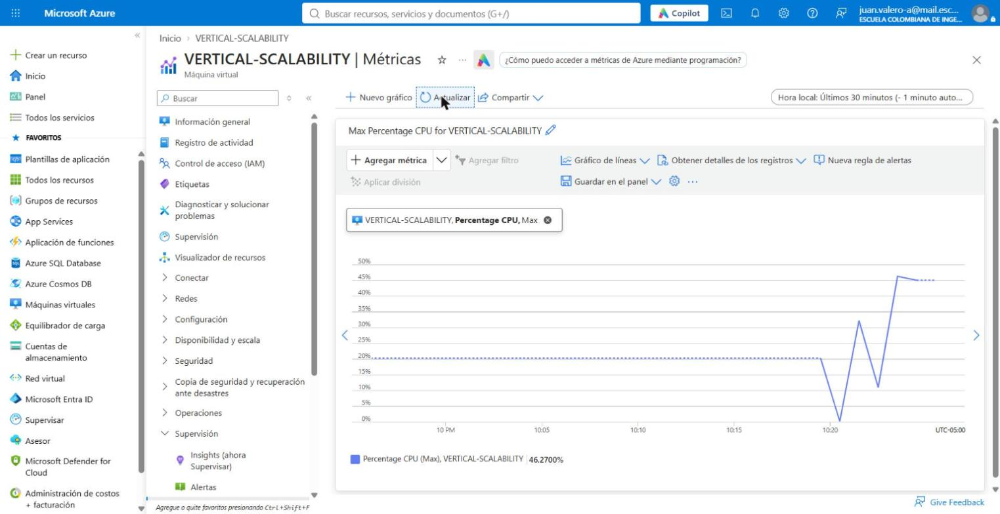

Periodo completo: de 10:22 a 10:27 corresponde al tamaño inicial (2 vCPU); la VM se reinicia por el cambio de tamaño hacia las 10:28; desde las 10:30 corresponde a `B4as_v2` (4 vCPU).

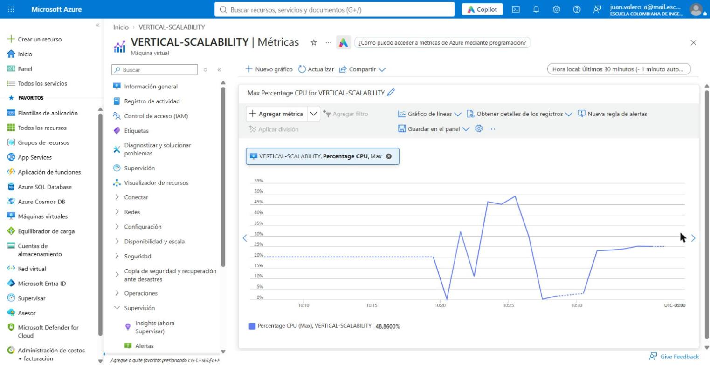

### 1.6 Carga concurrente con newman (pasos 9 y 11)

| Escenario | Peticiones | Exitosas | Fallidas | Tasa de éxito | Prom. (ms) | Máx. (ms) | Duración | Errores |
|---|---|---|---|---|---|---|---|---|
| `B2ats_v2` – 2 en paralelo × 10 | 20 | 14 | 6 | **70,0 %** | 9 593 | 12 270 | 87,6 s | `ECONNRESET` |
| `B4as_v2` – 2 en paralelo × 10 | 20 | 15 | 5 | **75,0 %** | 9 630 | 11 718 | 90,4 s | `ECONNRESET` |
| `B4as_v2` – 4 en paralelo × 10 | 40 | 35 | 5 | **87,5 %** | 18 225 | 39 234 | 198,3 s | `ECONNRESET` |

Resumen de newman por escenario. La tabla del reporter de newman se generó a partir de los reportes JSON que exportó cada ejecución (`reports/<escenario>/newman-N.json`; por su tamaño, en el repositorio solo se incluyen los resúmenes `reports/<escenario>/summary.md` y `reports/times-*.md`):

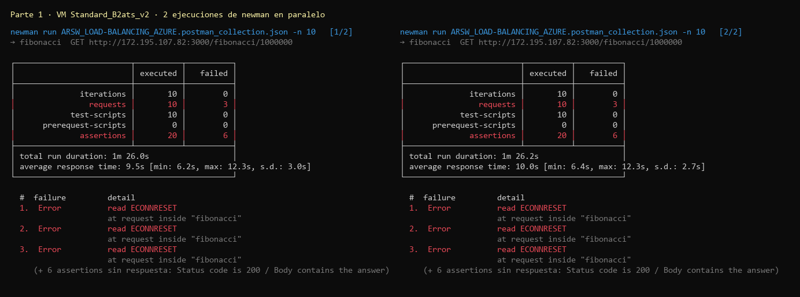

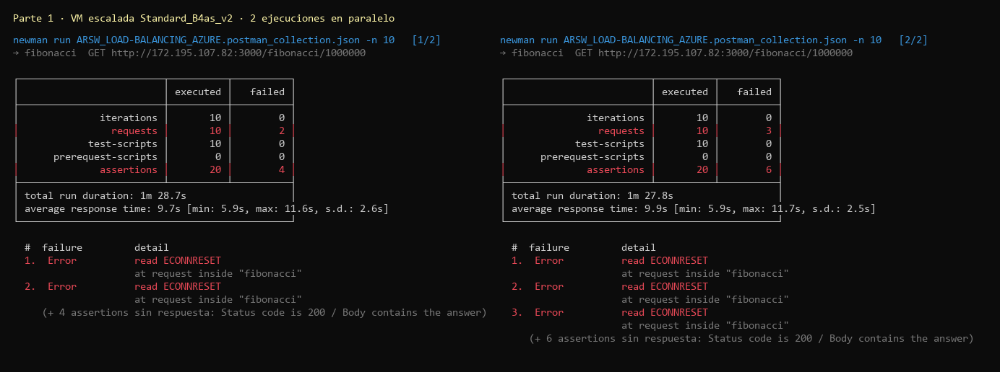

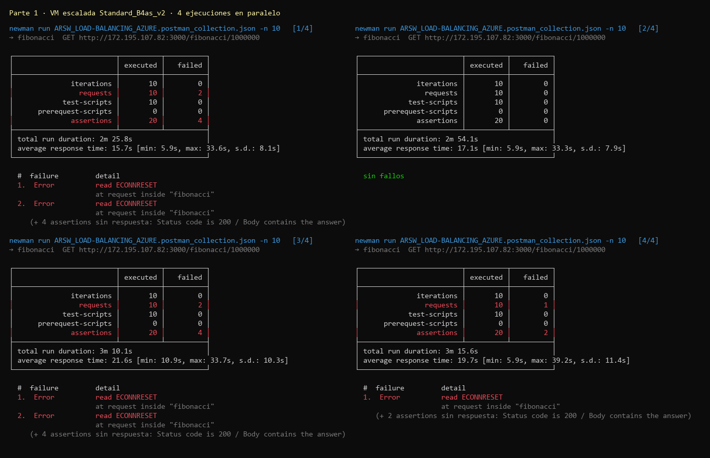

Detalle por ejecución:

<details><summary>B2ats_v2 – 2×10</summary>

| Ejecución | Peticiones | Exitosas | Fallidas | Mín (ms) | Prom (ms) | Máx (ms) | Errores |
|---|---|---|---|---|---|---|---|
| 1 | 10 | 7 | 3 | 6195 | 9636 | 12260 | ECONNRESET |
| 2 | 10 | 7 | 3 | 6353 | 9550 | 12270 | ECONNRESET |
</details>

<details><summary>B4as_v2 – 2×10</summary>

| Ejecución | Peticiones | Exitosas | Fallidas | Mín (ms) | Prom (ms) | Máx (ms) | Errores |
|---|---|---|---|---|---|---|---|
| 1 | 10 | 8 | 2 | 5862 | 9393 | 11618 | ECONNRESET |
| 2 | 10 | 7 | 3 | 5884 | 9867 | 11718 | ECONNRESET |
</details>

<details><summary>B4as_v2 – 4×10</summary>

| Ejecución | Peticiones | Exitosas | Fallidas | Mín (ms) | Prom (ms) | Máx (ms) | Errores |
|---|---|---|---|---|---|---|---|
| 1 | 10 | 8 | 2 | 5918 | 15260 | 33555 | ECONNRESET |
| 2 | 10 | 10 | 0 | 5859 | 17129 | 33340 | - |
| 3 | 10 | 8 | 2 | 10870 | 20814 | 33673 | ECONNRESET |
| 4 | 10 | 9 | 1 | 5909 | 19698 | 39234 | ECONNRESET |
</details>

### 1.7 Escalamiento vertical (paso 10)

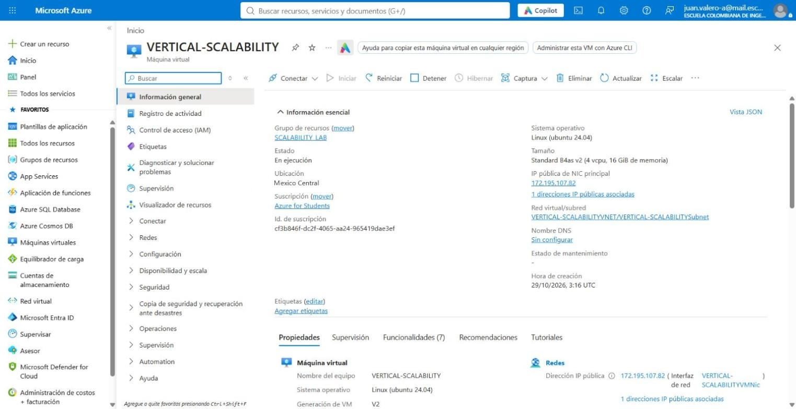

Después de las pruebas, la VM se devolvió a `Standard_B2ats_v2` (paso 13) y luego se eliminó el grupo de recursos antes de la parte 2.

### 1.8 Evaluación del escenario de calidad (paso 12)

> *Cuando un conjunto de usuarios consulta un enésimo número (> 1 000 000) de forma concurrente y el sistema está en condiciones normales, **todas** las peticiones deben ser respondidas y el consumo de CPU **no puede superar el 70 %**.*

| Criterio | Tamaño inicial | Escalado (4 vCPU) | ¿Se cumple? |
|---|---|---|---|
| Todas las peticiones respondidas | 70 % (2×) | 75 % (2×) / 87,5 % (4×) | **No** |
| CPU ≤ 70 % | Máx. ≈ 49 % | Máx. ≈ 25 % | Sí, pero engañoso |

**Conclusión:** el escalamiento vertical **no cumple** el escenario de calidad. La CPU de la VM nunca pasa del 70 % porque la aplicación solo puede usar **un núcleo**: es un único proceso Node.js con un solo hilo de ejecución. Con 2 vCPU el máximo es cerca del 50 % y con 4 vCPU cerca del 25 %. Pero ese núcleo sí está saturado al 100 %, las peticiones concurrentes hacen fila y una parte se pierde (`ECONNRESET`). Agregar núcleos o memoria a la misma máquina no aumenta la capacidad de esta aplicación.

### 1.9 Respuestas – Parte 1

**1. ¿Cuántos y cuáles recursos crea Azure junto con la VM?**
Además de la máquina virtual se crean **5 recursos**, 6 en total, como se ve en la captura 1.1:

| Recurso | Nombre |
|---|---|
| Máquina virtual | `VERTICAL-SCALABILITY` |
| Disco administrado del SO | `VERTICAL-SCALABILITY_OsDisk_1_…` |
| Interfaz de red (NIC) | `VERTICAL-SCALABILITYVMNic` |
| Dirección IP pública (Standard, estática) | `VERTICAL-SCALABILITYPublicIP` |
| Grupo de seguridad de red (NSG) | `VERTICAL-SCALABILITYNSG` |
| Red virtual (con su subred) | `VERTICAL-SCALABILITYVNET` / `VERTICAL-SCALABILITYSubnet` |

**2. ¿Para qué sirve cada recurso?**
- **Máquina virtual:** el cómputo (vCPU y RAM) donde corren Ubuntu y la FibonacciApp.
- **Disco del SO:** almacenamiento persistente con el sistema operativo y la aplicación. Está desacoplado del host físico, por eso sobrevive a reinicios y cambios de tamaño.
- **NIC:** conecta la VM a la subred; tiene la IP privada y referencia la IP pública y el NSG.
- **IP pública:** dirección accesible desde Internet para SSH y para consumir el servicio. Es estática, así que se conservó (`172.195.107.82`) después del cambio de tamaño.
- **NSG:** firewall con estado que filtra el tráfico de entrada y salida (SSH 22 y, luego, 3000).
- **VNet y subred:** red privada aislada donde vive la NIC; asigna la IP privada y permite comunicarse con otros recursos de Azure.

**3. ¿Por qué se cae la aplicación al cerrar la conexión SSH? ¿Por qué hay que crear un *Inbound port rule*?**
Al ejecutar `node FibonacciApp.js` en primer plano, el proceso es hijo de la shell de la sesión SSH y queda ligado a su terminal. Al cerrar la conexión, `sshd` termina la sesión y el kernel envía **SIGHUP** al grupo de procesos de esa terminal. Node no maneja esa señal y termina; la evidencia 1.3 muestra que, tras cerrar SSH, el puerto 3000 deja de responder. `forever` lanza la app como demonio desacoplado de la terminal y además la reinicia si falla. En este laboratorio también se agregó una entrada `@reboot` en `crontab` para que la app vuelva a subir sola después del reinicio que provoca el cambio de tamaño.
El *inbound port rule* es necesario porque el NSG que Azure crea con la VM solo permite el puerto 22 y termina con la regla `DenyAllInBound` (prioridad 65500). Sin la regla `3000 → Allow` (prioridad 1010), el tráfico HTTP al puerto 3000 se descarta antes de llegar a la VM, aunque la aplicación esté escuchando.

**4. Tabla de tiempos e interpretación**
Ver la tabla 1.4: entre **6,5 y 7,6 s** por petición, creciendo casi linealmente con *n*. La función tarda tanto porque:
- Es un **algoritmo iterativo O(n)**: para n = 1 000 000 hace un millón de iteraciones.
- Cada iteración suma **números enteros de precisión arbitraria** (`big-integer`). F(n) tiene unos 0,209·n dígitos, cerca de **209 000 dígitos** para n = 10⁶. Cada suma cuesta O(dígitos), así que el costo total es **O(n²)** en operaciones elementales. Además, cada iteración crea objetos nuevos que el recolector de basura debe liberar.
- Al final se convierte el resultado a texto decimal (`toString()`) y se envía una respuesta de unos 200 KB.
- No hay memoización ni caché: cada petición recalcula todo desde cero.

**5. Consumo de CPU e interpretación**
Ver las capturas 1.5. Con 2 vCPU la CPU máxima llegó a **≈ 46–49 %**, y con 4 vCPU a **≈ 23–25 %**: en ambos casos equivale a **un núcleo al 100 %**. El cálculo es CPU-bound puro (sin E/S), y Node.js ejecuta el código JavaScript en **un único hilo** (*event loop*). Mientras se calcula un Fibonacci, ese núcleo trabaja al máximo y los demás quedan ociosos. Por eso el porcentaje de la VM se estabiliza en 100 % / número de vCPU.

**6. Resumen de newman: tiempos y fallos**
Ver la tabla 1.6.
- **Tiempos:** el mínimo (≈ 5,9–6,3 s) coincide con el tiempo de cálculo aislado, porque es una petición que no tuvo que esperar. El promedio (≈ 9,6 s con 2 en paralelo; ≈ 18 s con 4) y el máximo (≈ 12 s; ≈ 39 s) crecen porque el servidor atiende **una petición a la vez**: con *k* clientes concurrentes, cada petición espera a que terminen las que llegaron antes.
- **Fallos:** todos fueron `ECONNRESET`, es decir, el servidor cerró la conexión TCP. Se verificó que la aplicación **no** se reinició y que no hubo falta de memoria. La causa es el *keep-alive* de HTTP: newman reutiliza la misma conexión para la siguiente petición, y Node cierra las conexiones inactivas tras `keepAliveTimeout` (5 s). Como el *event loop* está bloqueado unos 6 s calculando la petición del otro cliente, el temporizador vence y el servidor cierra el socket justo cuando el cliente envía la siguiente petición. Es un síntoma directo de la saturación del único hilo: con un solo cliente (medición 1.4) no hubo ningún fallo.

**7. Diferencia entre el tamaño inicial y el escalado (no solo infraestructura)**

| | `Standard_B2ats_v2` (usado en lugar de B1ls) | `Standard_B4as_v2` (usado en lugar de B2ms) |
|---|---|---|
| vCPU / RAM | 2 vCPU AMD / 1 GiB | 4 vCPU AMD / 16 GiB |
| Rendimiento base (*baseline*) | 20 % del total de vCPU (créditos de CPU para *burst*) | 40 % del total de vCPU |
| Créditos | Acumula pocos créditos; si se agotan, la VM queda limitada a su línea base | Acumula más créditos y tolera ráfagas largas |
| Precio (pago por uso, Linux, México Central)¹ | USD 0,0103/h (≈ 7,5/mes) | USD 0,165/h (≈ 120/mes), **16 veces más** |
| Uso pensado | Cargas mínimas o ociosas (dev/test, micro servicios con poco tráfico) | Servidores web o de aplicación con picos moderados |

Ambas son *burstable* (serie B): están pensadas para cargas que normalmente consumen poca CPU y tienen picos ocasionales. Una carga CPU-bound sostenida como esta agota los créditos y, en la VM pequeña, quedaría limitada a su línea base. La diferencia de fondo, más allá de las especificaciones, es el **costo frente a lo que realmente se aprovecha**: la VM grande cuesta mucho más, pero la aplicación solo usa un núcleo.

En el enunciado original, `B1ls` (1 vCPU, 0,5 GiB, línea base 5 %, USD 0,00572/h) frente a `B2ms` (2 vCPU, 8 GiB, línea base 60 %, USD 0,0915/h) tienen la misma relación: 16 veces el precio.

¹ Precios de la API pública *Azure Retail Prices* (`prices.azure.com`) para `mexicocentral`, consultados el 28-oct-2026.

**8. ¿Aumentar el tamaño de la VM es una buena solución? ¿Qué pasa con la FibonacciApp al cambiar el tamaño?**
**No**, en este escenario. El tiempo por petición casi no cambió (6 970 → 6 623 ms, −5 %, por un procesador algo más rápido por núcleo y más créditos) y la tasa de éxito con 2 clientes solo subió de 70 % a 75 %. La aplicación no aprovecha los núcleos adicionales porque es de un solo hilo, así que se paga 16 veces más por un beneficio mínimo. Habría que cambiar la aplicación (clúster de Node, *worker threads*, un algoritmo O(log n) por duplicación de matrices o caché) o escalar horizontalmente.
Al cambiar el tamaño, **la VM se apaga y se reinicia**: la FibonacciApp se detiene y el servicio queda **no disponible** durante el cambio (alrededor de 1,5–2 minutos en este caso). Volvió a subir sola gracias a la entrada `@reboot` del `crontab`; sin ella, habría que entrar por SSH y ejecutar de nuevo `forever start`.

**9. ¿Qué pasa con la infraestructura al cambiar el tamaño? ¿Qué efectos negativos implica?**
Azure desasigna la VM y la vuelve a asignar, a veces en otro host físico con capacidad para el nuevo tamaño. Se conservan el disco del SO, la NIC, la IP pública estática y el NSG. Efectos negativos:
- **Tiempo de inactividad**: no es un cambio en caliente.
- Se pierde todo el estado en memoria (sesiones, cachés) y los créditos de CPU acumulados.
- Una IP pública **dinámica** podría cambiar (aquí era estática).
- El tamaño deseado puede **no estar disponible** en el clúster o la región. En este laboratorio `B2ms` no lo estuvo.
- Hay un **techo**: el tamaño máximo de la familia o región.
- Sigue habiendo un **único punto de falla**: si la VM cae, el servicio cae.
- El costo crece más rápido que el beneficio obtenido.

**10. ¿Hubo mejora en el consumo de CPU o en los tiempos de respuesta? ¿Por qué?**
**Prácticamente no.**
- **CPU:** el porcentaje bajó (≈ 49 % → ≈ 25 %) solo porque el mismo trabajo (un núcleo saturado) ahora se divide entre 4 vCPU en vez de 2. No es una mejora real: el núcleo que usa Node sigue al 100 % y los otros tres están ociosos.
- **Tiempos:** −5 % en la medición secuencial y prácticamente iguales bajo carga (promedio ≈ 9,6 s en ambos casos con 2 clientes), porque el cálculo sigue en un solo hilo y las peticiones se atienden en serie.

**11. Con 4 ejecuciones paralelas, ¿el comportamiento es porcentualmente mejor?**
La tasa de éxito pasó de 75 % (15/20) con 2 ejecuciones a **87,5 % (35/40)** con 4. Porcentualmente parece mejor, pero el sistema **no** se comportó mejor:
- **Rendimiento (*throughput*):** igual. Se completaron unas 35 peticiones en 198 s (≈ 0,18 req/s) frente a 15 en 90 s (≈ 0,17 req/s). Es el límite de un núcleo calculando una petición cada ~6 s.
- **Latencia:** se duplicó. El promedio pasó de 9,6 s a 18,2 s y el máximo de 11,7 s a 39,2 s, porque la fila es el doble de larga.
- **Por qué hay menos `ECONNRESET` proporcionalmente:** con 4 clientes casi siempre hay una petición nueva esperando en el *socket*, y la conexión de cada cliente se reutiliza en una ventana diferente. Hay menos coincidencias exactas entre el vencimiento del *keep-alive* y el envío de la siguiente petición; es un efecto de temporización, no de capacidad.

En términos del escenario de calidad, el sistema sigue sin responder todas las peticiones y los usuarios esperan el doble.

---

## Parte 2 – Escalabilidad horizontal

### 2.1 Infraestructura desplegada

Se borró el grupo de recursos de la parte 1 y se creó uno nuevo con los nombres de las imágenes del enunciado:

| Recurso | Configuración |
|---|---|
| Load Balancer `SCALABILITY_LAB_LOAD_BALANCER` | Público, **SKU Standard**, frontend `LoadBalancerFrontEnd` |
| IP pública `SCALABILITY_LAB_LOAD_BALANCER_IP` | Standard, estática, **zone-redundant** (zonas 1, 2, 3): `68.155.198.102` |
| Backend pool `SCALABILITY_LAB_BACKEND_POOL` | NICs de VM1, VM2 y VM3 |
| Health probe `SCALABILITY_LAB_HEALTH_PROBE` | TCP, puerto 3000, intervalo 5 s |
| LB rule `SCALABILITY_LAB_LOAD_BALANCING_RULE` | TCP 80 → 3000, persistencia **None**, idle timeout 4 min, floating IP desactivada |
| Outbound rule `SCALABILITY_LAB_OUTBOUND_RULE` | SNAT de salida por la IP del LB (ver nota) |
| VNet `SCALABILITY_LAB_VIRTUAL_NETWORK` | `10.1.0.0/16`, subred `SCALABILITY_LAB_SUBNET` `10.1.0.0/24` |
| NSG `LOAD_BALANCER_NSG` (compartido) | `default-allow-ssh` (1000, 22) y `Port_3000` (1010, 3000) |
| VM1 / VM2 / VM3 | `Standard_B2ats_v2`, Ubuntu 24.04, zonas **1 / 3 / 3**, IPs privadas 10.1.0.4 / .5 / .6 |

La aplicación se instaló en cada nodo de forma automática con **cloud-init**, que ejecuta `scripts/setup-vm.sh` al crear la VM; es una de las herramientas de automatización que menciona el enunciado.

> **Restricciones de la suscripción encontradas en esta parte** (todas con evidencia del CLI):
> - **Zonas:** la **zona 2** de México Central no tenía capacidad para ningún tamaño de 2 vCPU (`SkuNotAvailable` para B2ats_v2, B2als_v2, B2as_v2, B2s_v2 y B2ls_v2). Por eso VM1 quedó en la zona 1 y VM2 y VM3 en la zona 3. La solución sigue repartida en **dos** zonas de disponibilidad.
> - **IPs públicas:** Azure for Students limita a **3 IPs públicas por región** (`PublicIPCountLimitReached`). Con la del balanceador solo cabían dos más, así que los nodos quedaron **sin IP pública**: el tráfico entrante llega únicamente por el balanceador, que es lo recomendado. Para que los nodos tuvieran salida a Internet (cloud-init descarga nvm, Node y el repositorio) se creó una **regla de salida** del balanceador y se desactivó el SNAT de la regla de balanceo. Azure no permite mezclar nodos con IP pública y reglas de salida (`NicWithPublicIpCannotReferencePoolWithOutboundRule`), por lo que también se retiró la IP pública de VM1.
> - **Cuota de vCPU:** el límite *Total Regional vCPUs* es **6**. Tres VMs de 2 vCPU lo agotan, así que la **cuarta VM** del punto 3 no se pudo crear (evidencia 2.5).

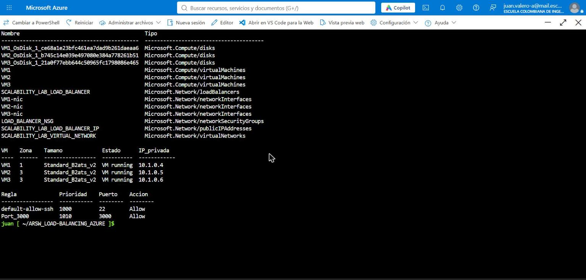

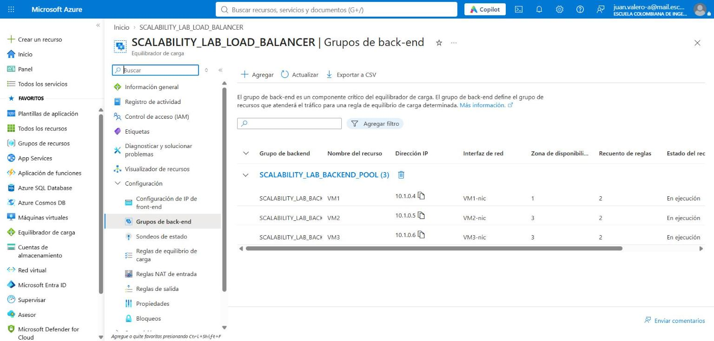

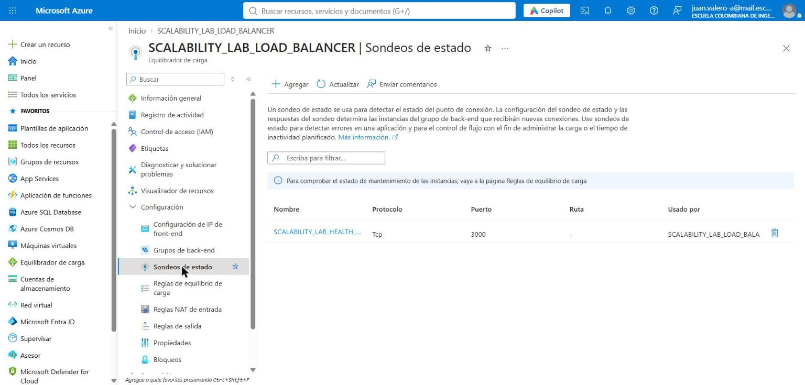

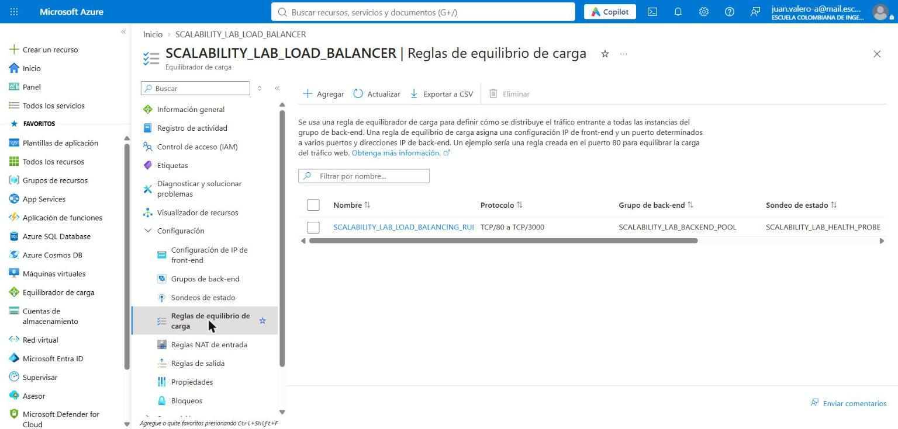

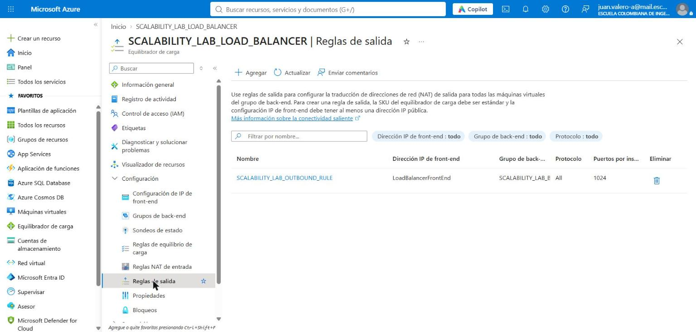

### 2.2 Prueba básica del balanceador (punto 1)

```
$ curl -i http://68.155.198.102/
HTTP/1.1 200 OK
X-Served-By: VM2
Hello World

$ curl -i http://68.155.198.102/fibonacci/1     (15 veces)
   8 X-Served-By: VM1
   5 X-Served-By: VM2
   2 X-Served-By: VM3
```

La aplicación agrega la cabecera `X-Served-By` con el *hostname* del nodo que respondió, lo que permite ver que el balanceador reparte las conexiones entre los tres nodos.

### 2.3 Informe comparativo (punto 2)

**Tiempos secuenciales a través del balanceador:**

| n | Tiempo (ms) | Nodo |
|---|---|---|
| 1 000 000 | 6 393 | VM1 |
| 1 010 000 | 6 514 | VM3 |
| 1 020 000 | 6 640 | VM3 |
| 1 030 000 | 6 773 | VM1 |
| 1 040 000 | 6 925 | VM2 |
| 1 050 000 | 7 077 | VM2 |
| 1 060 000 | 7 140 | VM2 |
| 1 070 000 | 7 260 | VM2 |
| 1 080 000 | 7 397 | VM3 |
| 1 090 000 | 7 535 | VM2 |
| **Promedio** | **6 965** | |

**Newman con 2 ejecuciones en paralelo × 10 iteraciones (mismo comando de la parte 1):**

| Ejecución | Peticiones | Exitosas | Fallidas | Mín (ms) | Prom (ms) | Máx (ms) | Errores |
|---|---|---|---|---|---|---|---|
| 1 | 10 | 10 | 0 | 6253 | 6303 | 6470 | - |
| 2 | 10 | 10 | 0 | 6258 | 6339 | 6574 | - |

**Tasa de éxito: 20/20 (100 %)**. Duración total: 66,7 s.

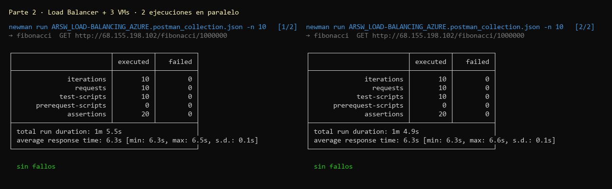

**Comparación vertical frente a horizontal:**

| Métrica (2 clientes × 10) | Vertical – 2 vCPU | Vertical – 4 vCPU | **Horizontal – LB + 3 VMs** |
|---|---|---|---|
| Peticiones exitosas | 14/20 (70 %) | 15/20 (75 %) | **20/20 (100 %)** |
| Tiempo promedio | 9 593 ms | 9 630 ms | **6 321 ms** |
| Tiempo máximo | 12 270 ms | 11 718 ms | **6 574 ms** |
| Duración total | 87,6 s | 90,4 s | **66,7 s** |
| Rendimiento (exitosas/s) | 0,16 | 0,17 | **0,30** |
| CPU máx. por VM | ≈ 49 % | ≈ 25 % | ≈ 46–48 % en cada nodo |

**Costos** (pago por uso, Linux, México Central¹):

| Concepto | Vertical (1 × `B4as_v2`) | Horizontal (3 × `B2ats_v2` + LB) |
|---|---|---|
| Cómputo | 1 × USD 0,165/h = **0,165** | 3 × USD 0,0103/h = **0,031** |
| IPs públicas Standard | 1 × 0,005 = 0,005 | 1 × 0,005 = 0,005 (solo la del LB) |
| Load Balancer Standard² | – | ≈ 0,025/h (hasta 5 reglas) + USD 0,005/GB procesado |
| **Total aprox.** | **≈ USD 0,170/h (≈ 124/mes)** | **≈ USD 0,061/h (≈ 45/mes)** |

² Precio de lista de Azure Load Balancer Standard; la API de precios no devolvió el medidor para esta región.

**Análisis.** Con el **mismo número de clientes**, la infraestructura horizontal respondió **todas** las peticiones (100 % frente a 70–75 %), con un tiempo promedio igual al tiempo de cálculo puro (≈ 6,3 s, sin fila) y el doble de rendimiento, costando cerca de un **tercio** de la VM escalada verticalmente. La razón es que cada cliente quedó atendido por un nodo distinto: con persistencia *None*, el balanceador asigna cada conexión TCP con un hash de 5 tuplas, y como newman reutiliza la conexión (*keep-alive*), cada ejecución "se pega" a un nodo. Ningún hilo de Node tuvo que atender dos peticiones a la vez, así que no hubo fila ni `ECONNRESET`. En términos de capacidad, la arquitectura horizontal suma **un hilo de Node por nodo**, que es lo único que esta aplicación puede aprovechar.

### 2.4 Cuarta VM y 4 ejecuciones en paralelo (punto 3)

No fue posible crear la **VM4**: la suscripción tiene una cuota de **6 vCPU regionales**, ya consumida por VM1–VM3 (3 × 2 vCPU), y no había tamaños de 1 vCPU disponibles en ninguna región permitida:

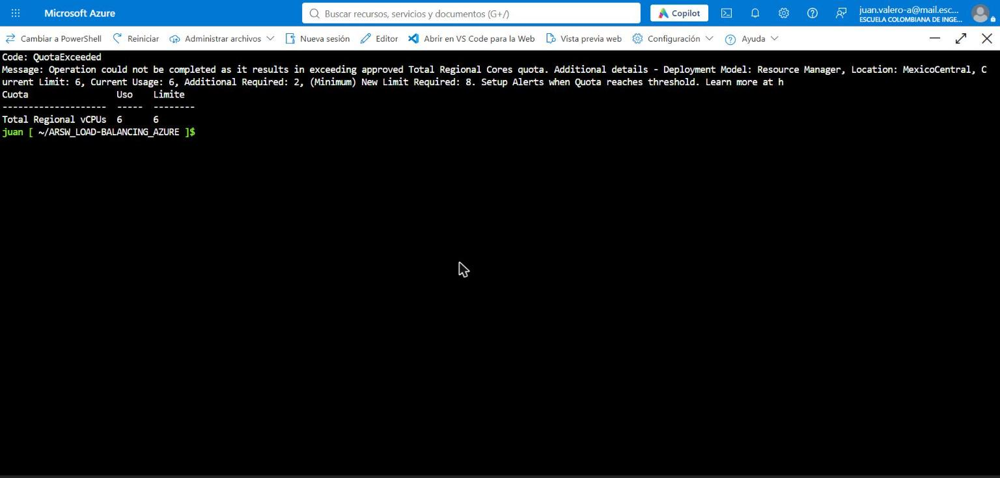

Por eso la prueba de **4 ejecuciones en paralelo** se hizo con los **3 nodos** disponibles:

| Ejecución | Peticiones | Exitosas | Fallidas | Mín (ms) | Prom (ms) | Máx (ms) | Errores |
|---|---|---|---|---|---|---|---|
| 1 | 10 | 10 | 0 | 6196 | 7342 | 11847 | - |
| 2 | 10 | 7 | 3 | 6197 | 8781 | 12622 | ECONNRESET |
| 3 | 10 | 9 | 1 | 6210 | 7603 | 12365 | ECONNRESET |
| 4 | 10 | 10 | 0 | 6249 | 6865 | 12321 | - |

**Tasa de éxito: 36/40 (90 %)**. Duración total: 82,5 s.

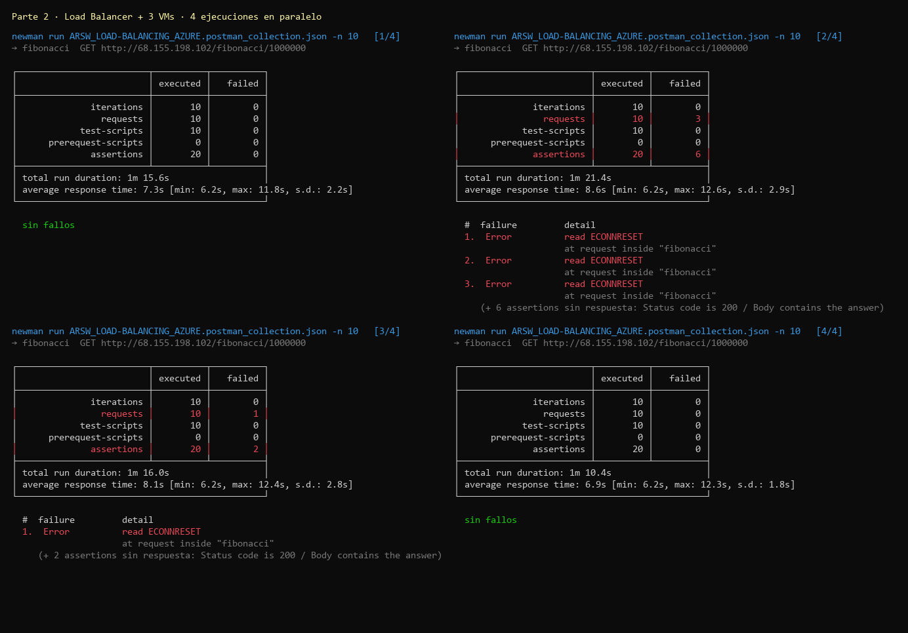

| Métrica (4 clientes × 10) | Vertical – 4 vCPU (1 VM) | **Horizontal – 3 VMs** |
|---|---|---|
| Peticiones exitosas | 35/40 (87,5 %) | **36/40 (90 %)** |
| Tiempo promedio | ≈ 18 225 ms | **≈ 7 648 ms** |
| Tiempo máximo | 39 234 ms | **12 622 ms** |
| Duración total | 198,3 s | **82,5 s** |
| Rendimiento (exitosas/s) | 0,18 | **0,44** |

**CPU de los nodos durante las pruebas** (Percentage CPU, Max, dividido por recurso):

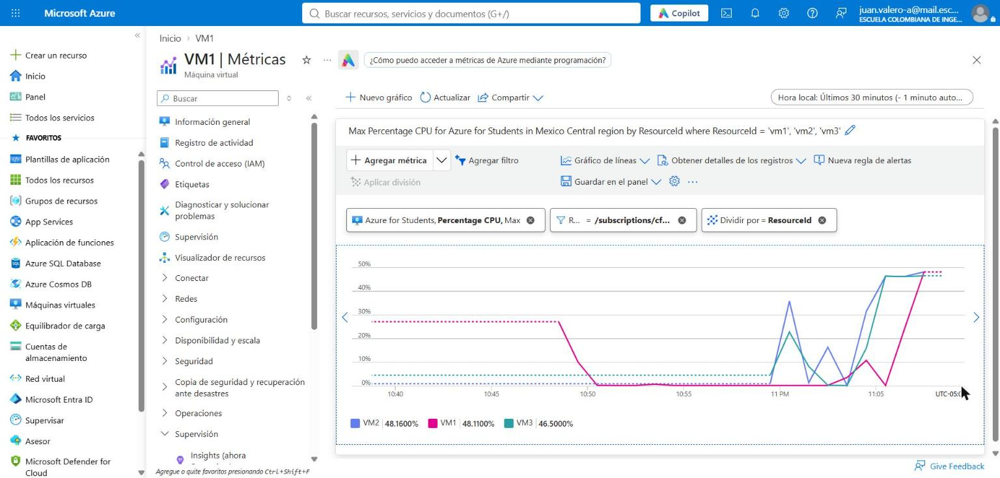

**¿Por qué aumentó la tasa de éxito con este estilo de escalabilidad?**
La CPU muestra que **los tres nodos trabajan al mismo tiempo**, cada uno con un núcleo ocupado (≈ 46–48 % de 2 vCPU). En la parte 1, en cambio, solo trabajaba un núcleo de toda la infraestructura. El balanceador reparte las conexiones, así que hay **tres hilos de Node calculando en paralelo** en lugar de uno. Por eso:
- El rendimiento se multiplica casi por el número de nodos: 0,18 → 0,44 peticiones exitosas por segundo, unas 2,5 veces más.
- La fila en cada nodo es más corta. Con 4 clientes y 3 nodos, a lo sumo un nodo atiende dos clientes, y solo esas peticiones esperan; por eso el máximo es ≈ 12 s, el tiempo de 2 cálculos, frente a 39 s.
- Los únicos `ECONNRESET` (4/40) aparecieron en las ejecuciones que compartieron nodo: es el mismo efecto *keep-alive* de la parte 1, que solo ocurre cuando hay más clientes que nodos. Con 4 nodos (1 cliente por nodo) se esperaría un comportamiento igual al de 2 clientes con 3 nodos, es decir, 100 %.

Además, si un nodo falla, el *health probe* lo saca del pool y los demás siguen atendiendo. Con la VM única de la parte 1, una falla dejaba todo el servicio caído.

### 2.5 Evaluación del escenario de calidad con escalamiento horizontal

| Criterio | 2 clientes / 3 nodos | 4 clientes / 3 nodos |
|---|---|---|
| Todas las peticiones respondidas | **Sí (100 %)** | No (90 %): hay más clientes que nodos |
| CPU ≤ 70 % | Sí (≈ 48 % por nodo) | Sí (≈ 48 % por nodo) |

El escenario se **cumple mientras haya al menos un nodo por cliente concurrente**. Para soportar más usuarios basta con agregar nodos al backend pool sin cambiar el punto de entrada, cosa que no era posible con el escalamiento vertical.

### 2.6 Diagrama de despliegue

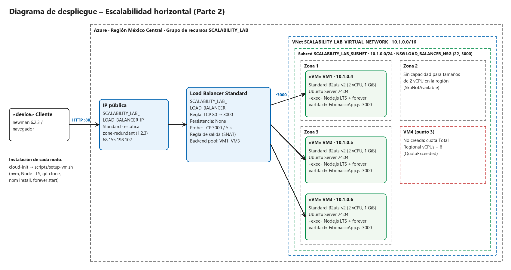

La misma vista en Mermaid (GitHub la muestra como diagrama):

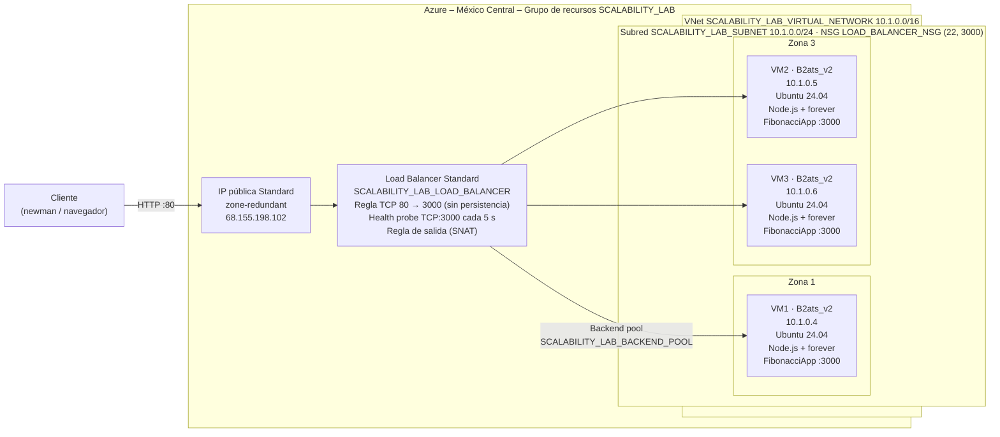

| Nodo / artefacto | Detalle |
|---|---|
| Cliente | Equipo externo con newman 6.2.3 (`tools/load-test.js`) o navegador |
| IP pública | `SCALABILITY_LAB_LOAD_BALANCER_IP`, Standard, estática, zone-redundant |
| Load Balancer | Standard, regla 80→3000, probe TCP:3000, regla de salida |
| Red | VNet `10.1.0.0/16`, subred `10.1.0.0/24`, NSG compartido (22 y 3000) |
| Nodos | 3 × `Standard_B2ats_v2` (2 vCPU, 1 GiB), Ubuntu 24.04, zonas 1/3/3 |
| Software por nodo | Node.js LTS (nvm) + `forever` + `FibonacciApp.js` (Express, puerto 3000); instalado con cloud-init (`scripts/setup-vm.sh`) |

### 2.7 Respuestas – Parte 2

**¿Cuáles son los tipos de balanceadores de carga en Azure y en qué se diferencian?**

| Servicio | Capa | Alcance | Uso típico |
|---|---|---|---|
| **Azure Load Balancer** | 4 (TCP/UDP) | Regional | Repartir conexiones TCP/UDP entre VMs. Es el usado en este laboratorio. |
| **Application Gateway** | 7 (HTTP/HTTPS) | Regional | Enrutamiento por URL o *host*, terminación TLS, WAF y afinidad por cookie. |
| **Front Door** | 7 | Global | Entrada global con CDN, aceleración y WAF. |
| **Traffic Manager** | DNS | Global | Reparte por DNS entre regiones o endpoints. |

Además, el Load Balancer puede ser **público** (frontend con IP pública, recibe tráfico de Internet) o **interno** (frontend con IP privada dentro de la VNet).

**¿Qué es SKU, qué tipos hay y en qué se diferencian?**
SKU (*Stock Keeping Unit*) es la variante o nivel de un recurso: define sus capacidades, SLA y precio. Para Load Balancer e IP pública:
- **Basic:** sin SLA ni zonas de disponibilidad, abierto por defecto, hasta 300 instancias. **Se retiró el 30-sep-2025.**
- **Standard:** SLA del 99,99 %, soporta zonas (zonal o *zone-redundant*), **seguro por defecto** (necesita un NSG que permita el tráfico), hasta 1 000 instancias, métricas en Azure Monitor, reglas de salida y HA ports. Es el que se usó.
- **Gateway:** para encadenar *appliances* virtuales de red (NVA) de forma transparente.

**¿Por qué el balanceador de carga necesita una IP pública?**
Porque es el **único punto de entrada** del sistema desde Internet. Los clientes no conocen los nodos (en esta implementación ni siquiera tienen IP pública); solo conocen la IP del frontend. El balanceador recibe en esa IP (puerto 80) y reenvía a las IPs privadas de los nodos (puerto 3000). Aquí la misma IP sirvió además como IP de **salida** (SNAT) de los nodos. Un balanceador interno no la necesita, pero solo sería accesible desde dentro de la VNet.

**¿Cuál es el propósito del *Backend Pool*?**
Es el conjunto de destinos (NICs o IPs de las VMs) entre los que se reparte el tráfico. Escalar horizontalmente consiste en agregar o quitar miembros del pool sin cambiar la IP pública que usan los clientes.

**¿Cuál es el propósito del *Health Probe*?**
Verifica periódicamente cada nodo; aquí, una conexión TCP al puerto 3000 cada 5 s. Si un nodo deja de responder, el balanceador no le envía conexiones nuevas hasta que se recupere. Así se evita mandar tráfico a una VM caída o a una aplicación que no arrancó. Durante el despliegue esto se observó: VM2 no recibió tráfico hasta que su aplicación quedó instalada.

**¿Cuál es el propósito de la *Load Balancing Rule*? ¿Qué tipos de sesión persistente existen, por qué esto es importante y cómo puede afectar la escalabilidad del sistema?**
La regla une frontend, backend pool y probe: define que el tráfico TCP del puerto 80 del frontend se distribuya al puerto 3000 de los nodos sanos.
Modos de persistencia de sesión (*distribution mode*):
- **None (hash de 5 tuplas):** IP y puerto de origen, IP y puerto de destino y protocolo. Cada conexión nueva puede ir a un nodo distinto; es el modo que mejor reparte.
- **Client IP (hash de 2 tuplas):** el mismo cliente (IP de origen) siempre va al mismo nodo.
- **Client IP and protocol (hash de 3 tuplas):** igual que el anterior, pero también por protocolo.

Importa cuando la aplicación guarda estado en la memoria del nodo (sesiones, carritos): sin afinidad, el usuario "perdería" su sesión al cambiar de nodo. Pero la afinidad **perjudica la escalabilidad**: si muchos usuarios salen a Internet por la misma IP (el NAT de una universidad, por ejemplo), todos caen en el mismo nodo, la carga se desbalancea y agregar nodos no ayuda. Por eso conviene diseñar servicios **sin estado**, como la FibonacciApp, y usar *None*. En las pruebas, todos los clientes salían desde la misma IP; con *Client IP* todo el tráfico habría ido a un único nodo y el resultado habría sido igual al de la parte 1.

**¿Qué es una *Virtual Network*? ¿Qué es una *Subnet*? ¿Para qué sirven los *address space* y *address range*?**
- **Virtual Network (VNet):** red privada y aislada en Azure donde se comunican los recursos (VMs, balanceador interno, etc.) como en una red local.
- **Subnet:** segmento de la VNet al que se conectan las NICs. Permite separar recursos y aplicarles NSG y rutas distintas.
- **Address space:** el bloque CIDR privado total de la VNet (`10.1.0.0/16`, 65 536 direcciones).
- **Address range:** el subconjunto de ese espacio asignado a cada subred (`10.1.0.0/24`, 256 direcciones, de las que Azure reserva 5; por eso la primera VM recibió la `.4`). Los rangos no pueden solaparse entre subredes ni con redes con las que se haga *peering*.

**¿Qué son las *Availability Zones* y por qué seleccionamos 3 diferentes zonas? ¿Qué significa que una IP sea *zone-redundant*?**
Una zona de disponibilidad es uno o varios datacenters físicamente separados dentro de una región, con energía, refrigeración y red independientes. Al repartir los nodos en zonas distintas, la caída de un datacenter completo solo se lleva los nodos de esa zona: el probe los saca del pool y el servicio sigue respondiendo con los demás (SLA del 99,99 % para VMs en 2 o más zonas). En este despliegue se usaron las zonas 1 y 3, porque la zona 2 no tenía capacidad: si cae la zona 3 sigue VM1, y si cae la zona 1 siguen VM2 y VM3.
Una IP **zone-redundant** se publica desde las tres zonas a la vez, de modo que sigue funcionando aunque falle una zona completa. Una IP **zonal** depende de una sola zona. Por eso la IP del balanceador se creó con `--zone 1 2 3`.

**¿Cuál es el propósito del *Network Security Group*?**
Es un firewall con estado a nivel de NIC o subred: reglas de entrada y salida evaluadas por prioridad (origen, destino, puerto, protocolo, Allow/Deny). Aquí permite SSH (22) y la aplicación (3000) y bloquea todo lo demás (`DenyAllInBound`). Con Load Balancer **Standard** es obligatorio, porque sin una regla que permita el 3000 el tráfico balanceado no llega a las VMs. La regla predeterminada `AllowAzureLoadBalancerInBound` es la que deja pasar los health probes.

**Informe de newman 1 (punto 2):** ver la sección 2.3.

**Diagrama de despliegue:** ver la sección 2.6.

---

## Conclusiones

1. **El escalamiento vertical no resolvió el problema.** La FibonacciApp es CPU-bound y de un solo hilo: más vCPU en la misma máquina no aumentan su capacidad (el tiempo bajó 5 % y el rendimiento quedó igual), mientras el costo se multiplicó por 16 y el cambio de tamaño causó tiempo de inactividad.
2. **El escalamiento horizontal sí escaló.** Cada nodo aporta un hilo de ejecución adicional. Con 3 nodos y 2 clientes se respondió el 100 % de las peticiones sin fila, y con 4 clientes el rendimiento fue unas 2,5 veces el de la VM grande, a cerca de un tercio de su costo y con tolerancia a fallos por zona.
3. **El escenario de calidad se cumple con escalamiento horizontal** siempre que haya al menos tantos nodos como peticiones concurrentes. Si esto no se garantiza, también habría que mejorar la aplicación: un algoritmo O(log n), caché de resultados o *worker threads*.
4. **Las restricciones reales de la nube son parte del diseño.** Disponibilidad de SKUs por región y zona, cuotas de vCPU y límites de IPs públicas obligaron a cambiar tamaños, zonas y la forma de dar salida a Internet a los nodos.

---

## Limpieza

Al terminar se eliminó el grupo de recursos `SCALABILITY_LAB` completo (`azure/cleanup.sh`), con lo que se borraron las VMs, los discos, el balanceador, las IPs públicas, el NSG y la VNet.

---

## Anexo – Video de la ejecución en Azure

El laboratorio completo se volvió a ejecutar el **29/10/2026 entre las 09:35 y las 10:47** (hora de Colombia) y se grabó en tiempo real: portal de Azure y Cloud Shell, sin voz y con títulos por sección. El video es [`video/laboratorio-escalamiento-azure.mp4`](video/laboratorio-escalamiento-azure.mp4) (73 min). En la esquina inferior derecha se muestra la hora real de la grabación.

Entre las 10:12 y las 10:18 otra ventana tapó el navegador, así que ese tramo se retiró. En su lugar hay una tarjeta explicativa y el mismo paso regrabado a las 11:11: `part2-horizontal.sh infra` y `outbound`. En esa toma la IP del balanceador es otra (68.155.216.72); en el resto de la parte 2 es 68.155.198.84.

| Minuto | Sección |
|---|---|
| 00:00 | Inicio: suscripción Azure for Students (rol Propietario) |
| 01:01 | Configuración inicial: Cloud Shell, repositorio, cuota de vCPU y SKUs disponibles |
| 07:58 | Parte 1, paso 1: grupo de recursos y VM `VERTICAL-SCALABILITY` |
| 09:19 | Solución de problemas: `AllocationFailed` → VM en la zona 1 |
| 13:08 | Pasos 2–5: SSH e instalación de Node.js, FibonacciApp y forever |
| 15:17 | Paso 6: regla de entrada del puerto 3000 (portal) |
| 17:57 | Prueba `GET /fibonacci/6` desde fuera de la VM |
| 18:55 | Pregunta 3: sin forever no responde (HTTP 000); con forever sí (HTTP 200) |
| 19:34 | Paso 7: tiempos secuenciales (B2ats_v2) |
| 21:20 | Pasos 8–9: newman 2× en paralelo y métricas de CPU |
| 25:42 | Paso 10: escalamiento a `Standard_B4as_v2` desde el portal |
| 28:12 | Paso 11: VM escalada (tiempos, newman 2× y CPU) |
| 32:22 | Pregunta 11: newman 4× contra la VM escalada |
| 36:31 | Fin de la parte 1: eliminación de sus recursos |
| 36:40 | Tarjeta del tramo retirado y regrabación de la infraestructura del LB |
| 43:37 | Parte 2, paso 6: creación de VM1–VM3 |
| 45:33 | Solución de problemas: `ZonalAllocationFailed` en las zonas 1 y 3 → `Standard_B2ts_v2` |
| 51:56 | Estado de los nodos, backend pool y cloud-init |
| 54:29 | Prueba del Load Balancer (cabecera `X-Served-By`) |
| 55:01 | Punto 2: tiempos y newman 2× a través del LB |
| 57:14 | Verificación en el portal: front-end, backend pool, probe, regla y regla de salida |
| 61:11 | Punto 3: newman 4×, health probe por nodo y CPU de cada nodo |
| 64:26 | Intento de VM4: `QuotaExceeded` (límite 6, uso 6, se necesitan 2) |
| 67:10 | Verificación final del sistema completo |
| 68:18 | Limpieza: eliminación del grupo de recursos |

**Resultados de la ejecución grabada.** Son números distintos a los de las secciones anteriores, que corresponden a otra ejecución. La conclusión es la misma.

| Escenario | Tamaño | Éxito | Promedio por ejecución | Tiempo secuencial promedio |
|---|---|---|---|---|
| Parte 1, 2× | `B2ats_v2` (2 vCPU) | 15/20 (75 %) | 9,9 s y 10,1 s | 6 847 ms |
| Parte 1, 2× | `B4as_v2` (4 vCPU) | 20/20 (100 %) | 10,4 s y 10,9 s | 6 400 ms |
| Parte 1, 4× | `B4as_v2` (4 vCPU) | 34/40 (85 %) | 13,3 s – 21,5 s (máx. 32,6 s) | – |
| Parte 2, 2× | LB + 3 × `B2ts_v2` | 20/20 (100 %) | 6,0 s y 6,0 s | 6 566 ms |
| Parte 2, 4× | LB + 3 × `B2ts_v2` | 40/40 (100 %) | 5,9 s – 11,1 s | – |

- CPU de la VM de la parte 1 durante la carga: unos 40 % con 2 vCPU y 25 % con 4 vCPU. La app usa un solo hilo.
- Health probe al 100 % en los tres backends (10.1.0.4, 10.1.0.5 y 10.1.0.6).
- Reparto de 15 peticiones a través del LB: VM1 6, VM2 2 y VM3 7.
- En la parte 2 se usó `Standard_B2ts_v2` (2 vCPU, 1 GiB, igual que `B2ats_v2`) porque Azure no tenía capacidad de `B2ats_v2` en las zonas 1 y 3 en ese momento y sugirió ese tamaño en el mismo error.
